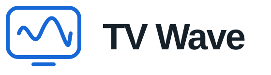

<p align="center"></p>
<p align="center"><a href="README.md">Русский</a> · <b>English</b></p>

TV Wave is an IPTV player for Android TV, Google TV and Android TV boxes. Add your playlist, watch channels, browse the programme guide and catch up on missed shows. Use your TV remote throughout the app.

**Important:** TV Wave plays content from sources you add yourself. It comes without bundled TV channels, films or IPTV subscriptions. TV Wave has no affiliation with content providers and does not support the use of unlawful sources. To watch content, you need your own playlist and permission to access the media it contains. Installing the app does not grant access to channels, streams or catch-up services.

## Features

- Add M3U/M3U8 playlists from a URL or file.
- Send playlist and programme guide URLs from your phone using a QR code on your home network.
- Browse the guide and programme descriptions while watching video in a small preview.
- Search channels and keep favourites and viewing history.
- Watch recordings or restart the current programme when your provider supports catch-up. Pause, seek and return to live TV.
- Update up to 10 XMLTV/XMLTV.GZ sources in the background. Reorder sources, match channels manually and adjust programme times.
- Choose the interface language and change text size from 60% to 130%.
- Back up settings, playlists and EPG source URLs. Programme caches are not included.

## Add a translation

Copy [en.json](app/src/main/assets/i18n/en.json) to the same folder using a language filename such as `de.json`. Set `locale` and `nativeName`, then translate the values in `strings`. Keep the keys and the `{p1}`, `{p2}` placeholders unchanged.

Run `python3 scripts/check_translations.py`, then send the JSON file or open a pull request. The new language will appear in the next build.

## Project structure

Main folders and files. Application code lives in `app`, translations in `assets/i18n`, and interface checks in `e2e`.

```text
app/
├── src/main/
│   ├── AndroidManifest.xml       — app declaration and Android permissions
│   ├── java/tv/tvwave/app/        — Kotlin application code
│   │   ├── MainActivity.kt       — screens and remote control navigation
│   │   ├── PlaybackHud.kt        — playback controls
│   │   ├── Repository.kt         — settings, playlists and EPG storage
│   │   ├── EpgUpdateService.kt   — background programme guide updates
│   │   ├── BackupFile.kt         — creating and reading backups
│   │   └── PhoneLink.kt          — receiving URLs from a phone
│   ├── assets/
│   │   ├── i18n/                 — interface translations in JSON
│   │   └── licenses/             — third-party licences
│   └── res/                      — icons, logos, styles and video surfaces
├── src/test/                     — application logic tests
├── src/androidTest/              — tests on Android devices and emulators
└── build.gradle.kts              — app dependencies and configuration
e2e/
├── maestro/                      — interface test flows
└── …                             — test servers and scripts for running checks
scripts/check_translations.py     — translation completeness and format checks
.github/
├── readme/                       — logo and saved screenshots
└── workflows/translations.yml    — automatic translation checks on GitHub
gradle/                          — Gradle Wrapper files
gradlew / gradlew.bat             — Gradle launchers for different operating systems
build.gradle.kts                 — shared Gradle configuration
settings.gradle.kts              — project modules and dependency repositories
gradle.properties                — Gradle and Android options
README.md / README.en.md          — descriptions in Russian and English
```

[Third-party licences](app/src/main/assets/licenses/NOTICE.txt)
