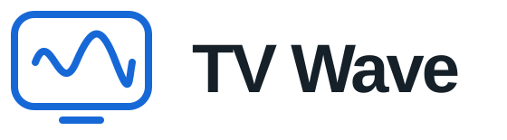

<p align="center"></p>
<p align="center"><b>Русский</b> · <a href="README.en.md">English</a></p>

TV Wave — IPTV-плеер для Android TV, Google TV и приставок на Android. Добавьте свой плейлист и смотрите каналы, открывайте программу передач и возвращайтесь к пропущенным выпускам. Всё управление работает с пульта.

**Важно:** TV Wave воспроизводит контент из источников, которые вы добавляете самостоятельно. В приложении нет встроенных телеканалов, фильмов или подписок на IPTV. TV Wave не связан с поставщиками контента и не поддерживает использование нелегальных источников. Для просмотра нужен собственный плейлист и право доступа к его содержимому. Установка приложения сама по себе не предоставляет доступ к каналам, трансляциям или архивам.

## Что умеет

- Подключать плейлисты M3U/M3U8 по ссылке или из файла.
- Принимать ссылки на плейлист и телепрограмму с телефона по QR-коду в домашней сети.
- Показывать телегид, описание передачи и видео в маленьком окне.
- Искать каналы, сохранять избранное и историю просмотра.
- Открывать записи и начинать текущую передачу сначала, если провайдер поддерживает архив. Доступны пауза, перемотка и возврат в эфир.
- Обновлять до 10 источников XMLTV/XMLTV.GZ в фоне. Можно менять их порядок, выбирать соответствие канала вручную и корректировать время.
- Менять язык интерфейса и размер текста от 60% до 130%.
- Сохранять настройки, плейлисты и адреса EPG в бекап. Кэш передач в него не входит.

## Добавить перевод

Скопируйте [en.json](app/src/main/assets/i18n/en.json) в ту же папку под именем языка, например `de.json`. Укажите `locale` и `nativeName`, переведите значения в `strings`. Ключи и параметры `{p1}`, `{p2}` оставьте без изменений.

Проверка: `python3 scripts/check_translations.py`. Затем пришлите JSON-файл или pull request. Новый язык появится в следующей сборке.

## Структура проекта

Основные папки и файлы. Код приложения находится в `app`, переводы — в `assets/i18n`, проверки интерфейса — в `e2e`.

```text
app/
├── src/main/
│   ├── AndroidManifest.xml       — описание приложения и разрешения Android
│   ├── java/tv/tvwave/app/        — код приложения на Kotlin
│   │   ├── MainActivity.kt       — экраны и управление с пульта
│   │   ├── PlaybackHud.kt        — панель управления воспроизведением
│   │   ├── Repository.kt         — хранение настроек, плейлистов и EPG
│   │   ├── EpgUpdateService.kt   — фоновое обновление телепрограммы
│   │   ├── BackupFile.kt         — создание и чтение резервных копий
│   │   └── PhoneLink.kt          — приём ссылок с телефона
│   ├── assets/
│   │   ├── i18n/                 — JSON-файлы переводов интерфейса
│   │   └── licenses/             — лицензии сторонних компонентов
│   └── res/                      — иконки, логотипы, стили и видеоповерхности
├── src/test/                     — тесты логики приложения
├── src/androidTest/              — тесты на Android-устройствах и эмуляторах
└── build.gradle.kts              — зависимости и настройки приложения
e2e/
├── maestro/                      — сценарии проверки интерфейса
└── …                             — тестовые серверы и скрипты запуска проверок
scripts/check_translations.py     — проверка полноты и формата переводов
.github/
├── readme/                       — логотип и сохранённые скриншоты
└── workflows/translations.yml    — автоматическая проверка переводов на GitHub
gradle/                          — файлы Gradle Wrapper
gradlew / gradlew.bat             — запуск Gradle на разных ОС
build.gradle.kts                 — общие настройки Gradle
settings.gradle.kts              — модули проекта и источники зависимостей
gradle.properties                — параметры Gradle и Android
README.md / README.en.md          — описание на русском и английском
```

[Лицензии сторонних компонентов](app/src/main/assets/licenses/NOTICE.txt)
